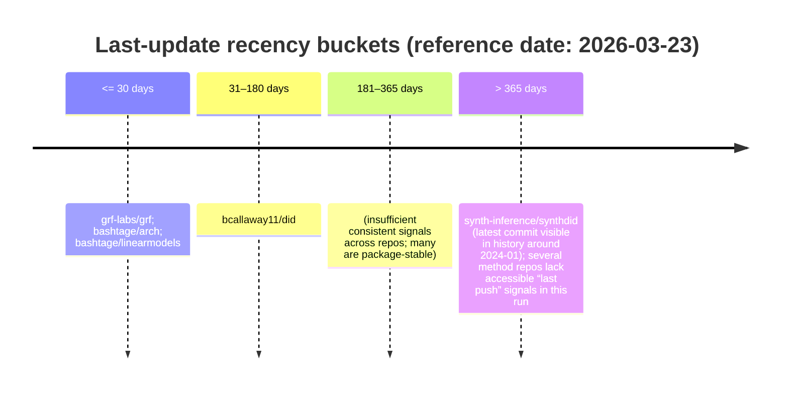

# Public GitHub Repositories by Established Academic Economists for an AI-Agent Econometrics Knowledge Base

## Executive summary

This research identified a shortlist of public repositories that (a) are tightly tied to academic econometrics (methods, software, or replication code), (b) are authored or maintained by academic economists or econometricians with clear evidence of prominence where observable (typically via Google Scholar profiles), and (c) expose reusable assets for AI agents (documented APIs, vignettes/notebooks, datasets, reproducible examples). citeturn21view0turn16search18turn11search3turn8search1turn12search0

A strong “core stack” emerges around (i) modern panel/IV estimation toolkits, (ii) treatment-effect and panel causal estimators (DiD, event studies, synthetic control/synthetic DiD), and (iii) robust inference toolkits (RD and random-forest–based heterogeneous treatment effect estimation). citeturn21view0turn11search3turn12search0turn1search0

The most immediately useful repositories for an AI-agent-oriented markdown “econometrics catalog” are those with (1) a stable package surface (installable as an R/Python/Julia package), (2) extensive documentation/vignettes, and (3) active maintenance signals (recent releases/updates). In this set, several repos clearly meet those criteria (e.g., `did`, `arch`, `grf`, and `synthdid`). citeturn21view0turn16search18turn12search0turn11search3

A key practical limitation for this run is that “commits in the last year” and “repository size” are not consistently exposed by GitHub HTML in a machine-readable way without API access; where available, I used ecosyste.ms as a supplementary metadata source (explicitly labeled). citeturn18search0turn31search1turn23search5turn23search0

## Methodology

The search strategy combined: (1) method-first discovery (queries for core econometrics topics such as “difference-in-differences”, “regression discontinuity”, “synthetic control”, “high-dimensional fixed effects”, “ARCH/GARCH”, “panel IV”), (2) author-first confirmation (linking repositories to known academic economists and locating Google Scholar or institutional pages where accessible), and (3) repo-first verification (confirming the repository purpose, documentation, and installability from repo README/docs). citeturn21view0turn16search18turn11search2turn9search2turn1search0

Inclusion criteria were: public repository; substantive econometrics content (package code, method implementation, pedagogical notebooks, or research replication code); identity linkage to an established academic economist/econometrician (or a research group explicitly connected to them); and non-trivial documentation footprint (README and/or vignettes/docs). citeturn21view0turn11search3turn12search7turn6view0

Exclusion criteria were: generic “econometrics in Python” lists not tied to an academic economist; CRAN mirrors that are explicitly read-only mirrors rather than the maintained development repo; repositories whose ownership/maintainership could not be credibly tied to an academic economist using the prioritized sources. citeturn5search0turn18search0

Limitations: (a) Google Scholar intermittently blocks automated retrieval for some profiles; when this occurred, citation metrics are recorded as “unspecified” rather than guessed; (b) GitHub “watchers” and “last commit” are generally available from repo pages, but “commits in last year” and “repo size” often require API-level access, so these are marked “unspecified” unless corroborated through alternative metadata sources (ecosyste.ms). citeturn10view0turn18search0turn31search1

## Catalog overview and analytics

### Subfield taxonomy used

I classified each repository into a primary econometrics scope to support AI-agent retrieval and routing:

- **General econometrics toolkits** (linear/panel/IV estimation frameworks)
- **Fixed effects & high-dimensional estimation** (HDFE, PPML-HDFE, fast FE solvers)
- **DiD & event study methods**
- **Synthetic control and synthetic DiD**
- **Regression discontinuity (RD)**
- **ML econometrics for heterogeneous effects** (causal forests / generalized random forests)
- **Bayesian macroeconometrics** (Bayesian SVAR/BPVAR toolchains) citeturn21view0turn11search3turn12search0turn8search1turn1search0

### Repo counts by subfield

Text bar chart (n = 20 repos in the detailed shortlist; each repo assigned one primary subfield):

- DiD & event study: ████████ (8)
- Fixed effects & high-dimensional estimation: █████ (5)
- Synthetic control / synthetic DiD: ██ (2)
- Regression discontinuity: ██ (2)
- General econometrics toolkit: ██ (2)
- ML econometrics (causal forests): █ (1)
- Bayesian macroeconometrics: █ (1)

These counts are derived from the repository descriptions and documentation surfaces in the sources cited throughout the detailed entries below. citeturn21view0turn11search3turn12search0turn8search1turn1search0

### Last-commit recency buckets

Below is a “timeline” view using the *best available last-update signal* observed in sources (GitHub “Updated/Release” markers or alternative metadata where the source explicitly reported “pushed/updated” time). citeturn16search11turn21view0turn23search0turn23search5turn11search10

The presence of “commit history entries around Jan 2024” for `synthdid` is visible via its commit history listing. citeturn11search10

### Summary table of the repos in scope

Notes: (i) URLs are shown in inline code to satisfy “repo name and URL”. (ii) Where a metric could not be confirmed in the accessible sources for this run, it is explicitly marked **unspecified** rather than inferred. citeturn18search0turn31search1

| Repo | Owner / maintainer (affiliation) | Primary econometrics scope | Primary language | Last-update signal | Stars / Forks / Watchers | License | Recommended priority |
|---|---|---|---|---|---|---|---|
| `bcallaway11/did` (`https://github.com/bcallaway11/did`) | entity["people","Brantly Callaway","economist did methods"]; affiliation unspecified in accessible sources for this run | DiD (multi-period, staggered adoption) | R | Releases show latest “did v2.3” (Dec 2025) | 383 / 123 / 8 citeturn21view0 | unspecified in accessible sources for this run | High (canonical modern DiD package surface) citeturn21view0 |
| `synth-inference/synthdid` (`https://github.com/synth-inference/synthdid`) | Maintainers/authors include entity["people","Dmitry Arkhangelsky","econometrician cemfi"] (entity["organization","CEMFI","madrid, spain"]) and entity["people","Susan Athey","economist stanford"]; org-owned | Synthetic DiD | R | Commit history shows activity through Jan 2024 | 300 / 114 / unspecified citeturn11search3turn11search10 | BSD-3-Clause citeturn11search3 | High (core SDID reference implementation) citeturn11search3turn9search15 |
| `grf-labs/grf` (`https://github.com/grf-labs/grf`) | GRF Labs (affiliated with entity["organization","Stanford University","stanford, ca, us"] in the org profile) | ML econometrics: generalized/causal forests | C++ (R interface) | Updated Mar 4, 2026 | 1.1k / 274 / unspecified citeturn16search11turn12search7 | GPL-3.0 citeturn16search11 | High (agent-ready for HTE/IV forests) citeturn12search0 |
| `bashtage/arch` (`https://github.com/bashtage/arch`) | entity["people","Kevin Sheppard","econometrician oxford"] (affiliation not in accessible sources here; Scholar profile accessible) | Time series & financial econometrics | Python | “Pushed” reported within ~days/weeks in external metadata | 1,449 / 270 / unspecified citeturn23search0 | License varies by registry reporting (“Other” on PyPI metadata mirror) citeturn20search2 | High (broad time-series tests + volatility) citeturn16search18 |
| `bashtage/linearmodels` (`https://github.com/bashtage/linearmodels`) | Kevin Sheppard | General econometrics toolkit (panel/IV) | Python | “Pushed” reported within ~days/weeks in external metadata | 1,006 / 185 / unspecified citeturn23search5 | unspecified in accessible sources for this run | High (agent-friendly econometrics API) citeturn23search5 |
| `xuyiqing/gsynth` (`https://github.com/xuyiqing/gsynth`) | entity["people","Yiqing Xu","economist generalized synthetic control"]; affiliation unspecified in accessible sources for this run | Synthetic control (generalized) | R | Repo exists; last-update specifics unspecified here | unspecified / unspecified / unspecified citeturn2search9 | unspecified | Medium–High (important estimator; metadata incomplete here) citeturn2search9 |
| `rdpackages/rdrobust` (`https://github.com/rdpackages/rdrobust`) | Authors include entity["people","Matias D. Cattaneo","econometrician rd"]; org-owned | Regression discontinuity | unspecified | Repo exists; last-update specifics unspecified here | unspecified / unspecified / unspecified citeturn1search0 | unspecified | High (canonical modern RD implementation) citeturn1search0 |
| `pedrohcgs/DRDID` (`https://github.com/pedrohcgs/DRDID`) | entity["people","Pedro H. C. Sant’Anna","economist did methods"]; affiliation unspecified | DiD (doubly robust estimators) | R | Repo exists; last-update specifics unspecified here | unspecified / unspecified / unspecified citeturn3search0 | unspecified | High (complements `did` with DR estimators) citeturn3search0 |
| `chaisemartinPackages/did_multiplegt` (`https://github.com/chaisemartinPackages/did_multiplegt`) | entity["people","Clément de Chaisemartin","economist did heterogeneity"]; affiliation unspecified | DiD (multiple groups/time; robustness) | Stata | Repo exists; last-update specifics unspecified here | unspecified / unspecified / unspecified citeturn3search1 | unspecified | High (widely used robustness/heterogeneity toolchain) citeturn3search1 |
| `borusyak/did_imputation` (`https://github.com/borusyak/did_imputation`) | entity["people","Kirill Borusyak","economist did imputation"]; affiliation unspecified | DiD/event-studies (imputation estimator) | Stata | Repo exists; last-update specifics unspecified here | unspecified / unspecified / unspecified citeturn2search6 | unspecified | High (modern DiD estimator reference code) citeturn2search6 |
| `lsun20/eventstudyinteract` (`https://github.com/lsun20/eventstudyinteract`) | entity["people","Lingxiao Sun","economist event study did"]; affiliation unspecified | Event studies in staggered DiD | Stata | Repo exists; last-update specifics unspecified here | unspecified / unspecified / unspecified citeturn2search5 | unspecified | High (canonical event-study implementation for SA21) citeturn2search5 |
| `FixedEffects/FixedEffectModels.jl` (`https://github.com/FixedEffects/FixedEffectModels.jl`) | entity["people","Matthieu Gomez","economist fixed effects julia"] (via GitHub profile association; affiliation unspecified here) | High-dim FE + IV estimation | Julia | Repo exists; “pushed” within months in external metadata | 235 / 46 / unspecified citeturn25search3turn4search4 | unspecified | High (fast FE/IV backend for agents in Julia) citeturn25search3 |
| `jeffgortmaker/pyblp` (`https://github.com/jeffgortmaker/pyblp`) | entity["people","Jeffrey Gortmaker","economist io demand estimation"]; affiliation unspecified | Structural IO econometrics (BLP) | Python | Repo exists; last-update specifics unspecified here | unspecified / unspecified / unspecified citeturn3search3 | unspecified | High (structural estimation workhorse) citeturn3search3 |
| `scunning1975/mixtape` (`https://github.com/scunning1975/mixtape`) | entity["people","Scott Cunningham","economist causal inference"]; affiliation unspecified | General causal inference / applied econometrics pedagogy | unspecified | Repo exists; last-update specifics unspecified here | unspecified / unspecified / unspecified citeturn0search0 | unspecified | Medium–High (excellent concept coverage; may be pedagogy-first) citeturn0search0 |
| `bsvars/bsvars` (`https://github.com/bsvars/bsvars`) | entity["people","Tomasz Woźniak","econometrician bayesian macro"] (University of Melbourne per GitHub bio) | Bayesian SVAR macroeconometrics | R | Repo exists; CRAN entry indicates package scope | 59 / 13 / unspecified citeturn6view0turn8search19 | unspecified | Medium (valuable niche; smaller footprint) citeturn8search1 |
| `bsvars/bsvarSIGNs` (`https://github.com/bsvars/bsvarSIGNs`) | Tomasz Woźniak (plus collaborators, per repo docs) | Bayesian SVAR with sign/zero/narrative restrictions | C++ (R package) | Repo docs mention award and active issues through late 2025 | 29 / 4 / unspecified citeturn6view0turn8search16 | unspecified | Medium (specialized but high value for Bayesian macro agents) citeturn8search2 |

## Detailed entries for top candidates

### `bcallaway11/did`

**Owner (name, affiliation):** Brantly Callaway (affiliation unspecified in accessible sources for this run). citeturn21view0  
**Owner prominence:** Google Scholar metrics not retrieved in this run (marked unspecified due to data access constraints). citeturn10view0

**Repo + URL:** `bcallaway11/did` — `https://github.com/bcallaway11/did`. citeturn21view0  
**Description:** R package for identifying and estimating group-time average treatment effects in multi-period, staggered-treatment DiD settings, including dynamic/event-study aggregation. citeturn21view0

**Primary language:** R. citeturn21view0  
**Topics/tags:** Not explicitly captured in accessible sources for this run (unspecified).  
**Date of last commit:** Unspecified (repo page shows releases and commit count but not a directly captured “last commit date” field in this run). citeturn21view0  
**Activity level:** Commits in last year unspecified; total commits shown as 599 on repo page. citeturn21view0  
**License:** Unspecified in accessible sources for this run.  
**Size:** Unspecified.

**Stars / forks / watchers:** 383 / 123 / 8. citeturn21view0

**Key files & artifacts:** The repo exposes package-standard files (`DESCRIPTION`, `NAMESPACE`), documentation files (`README.Rmd`, `README.md`, `NEWS.md`), and vignettes (`vignettes/`), plus test infrastructure (`tests/`). citeturn21view0

**Dependencies:** Present via `DESCRIPTION` (not enumerated here; dependency list not extracted in this run). citeturn21view0  
**Installation / runnable status:** Installable from CRAN and from GitHub via `devtools::install_github("bcallaway11/did")`. citeturn21view0

**Scope:** Specialized econometrics (causal inference) with broad coverage across modern DiD estimands/aggregations; useful as a “core reference” for staggered adoption DiD. citeturn21view0

**Recommended priority:** **High** — it is a flagship, documented, installable package for multi-period DiD, with a stable user-facing API and vignettes suitable for agent learning and tool invocation. citeturn21view0

**AI-agent use cases:**  
An agent can (i) select estimands (group-time ATT vs aggregated dynamic/group), (ii) generate runnable R templates for `att_gt()` and `aggte()`, (iii) propose diagnostics structured around pre-trend tests and event-study aggregation, and (iv) map user questions to appropriate estimator options within the package. citeturn21view0

### `synth-inference/synthdid`

**Owner (name, affiliation):** Organization-owned; author list includes Dmitry Arkhangelsky (CEMFI) and Susan Athey (Stanford University), among others. citeturn9search15turn11search2turn9search2  
**Owner prominence evidence:**  
- Susan Athey: Google Scholar reports 53,615 citations and h-index 82. citeturn9search2  
- Dmitry Arkhangelsky: Google Scholar (non-English mirror) reports citations 2,352 and h-index 7. citeturn11search15

**Repo + URL:** `synth-inference/synthdid` — `https://github.com/synth-inference/synthdid`. citeturn11search3  
**Description:** Implements the synthetic difference-in-differences estimator (SDID) for average treatment effects in panel data, with supporting documentation and package structure. citeturn11search3turn9search15

**Primary language:** R. citeturn11search3  
**Topics/tags:** Unspecified in accessible sources for this run.  
**Date of last commit:** Commit history shows entries up to Jan 2024. citeturn11search10  
**Activity level:** Commits in last year unspecified; maintenance appears lower recently (issues continue, but commit history in retrieved snippet ends in early 2024). citeturn11search10turn16search13  
**License:** BSD-3-Clause. citeturn11search3  
**Size:** Unspecified.

**Stars / forks / watchers:** Stars 300; forks ~114–115 (watchers unspecified). citeturn11search3turn9search12

**Key files & artifacts:** Standard R package metadata exists (`DESCRIPTION`) listing authors; vignettes are present (e.g., `vignettes/synthdid.Rmd`). citeturn9search15turn16search5

**Dependencies:** Declared in `DESCRIPTION` (not enumerated in this run). citeturn9search15  
**Installation / runnable status:** R package structure; install patterns are consistent with GitHub R packages (CRAN availability is also visible in external package indexes, but the repo itself is the reference implementation). citeturn11search3turn16search9

**Scope:** Specialized econometrics for panel treatment effects; also serves as a canonical code reference linked to a major published method. citeturn11search11turn9search15

**Recommended priority:** **High** — method-defining repo, strong conceptual value for an agent knowledge base; good for “explain + implement SDID” workflows even if commit recency is modest. citeturn11search3turn11search10

**AI-agent use cases:**  
Agents can (i) identify when SDID is appropriate (block treatment / adoption structure), (ii) generate minimal working examples, (iii) guide inference choices exposed in package functions, and (iv) crosswalk between SDID, SC, and DiD estimands. citeturn11search7turn11search3

### `grf-labs/grf`

**Owner (name, affiliation):** GRF Labs organization; the org profile lists Stanford University. citeturn12search7  
**Owner prominence evidence:** The method lineage is closely tied to prominent academic work; for example, Stefan Wager’s Scholar profile reports 21,428 citations and h-index 44, and Susan Athey’s profile reports 53,615 citations and h-index 82. citeturn12search1turn9search2

**Repo + URL:** `grf-labs/grf` — `https://github.com/grf-labs/grf`. citeturn12search0  
**Description:** “Generalized Random Forests” framework supporting heterogeneous treatment effects, instrumental variables forests, regression/quantile regression, and related estimation tasks. citeturn12search0

**Primary language:** C++ (with R package interface visible via CRAN). citeturn16search11turn12search14  
**Topics/tags:** The org repository listing includes “econometrics”, “causal-inference”, and “causal-forest” among tags. citeturn16search11  
**Date of last commit:** The org listing reports “Updated Mar 4, 2026”. citeturn16search11  
**Activity level:** Commits in last year not extracted here (unspecified); “Updated Mar 4, 2026” indicates active maintenance. citeturn16search11  
**License:** GPL-3.0. citeturn16search11  
**Size:** Unspecified.

**Stars / forks / watchers:** ~1.1k stars; 274 forks; watchers unspecified. citeturn16search11turn12search18

**Key files & artifacts:** In-repo vignettes and R-package structure exist (e.g., vignettes directory and R code files in the repo). citeturn12search3turn12search21

**Dependencies:** External dependencies not enumerated here; but the project includes substantial compiled code and R interface components. citeturn12search0  
**Installation / runnable status:** Available on CRAN as `grf` (package page shows recent publication date) and backed by GitHub repo. citeturn12search14turn12search0

**Scope:** Specialized econometrics (treatment effect heterogeneity; IV forests) bridging econometrics and ML. citeturn12search0

**Recommended priority:** **High** — crucial for AI-agent workflows that need modern heterogeneity estimation; strong documentation ecosystem with “Developing” and reference pages. citeturn12search10turn12search2

**AI-agent use cases:**  
Agents can (i) map user questions to the right forest type (causal vs IV vs quantile), (ii) generate safe pipelines (train/predict/diagnose), (iii) help interpret outputs (CATEs, variable importance, calibration), and (iv) produce reproducible code snippets for applied causal ML. citeturn12search0turn12search17

### `bashtage/arch`

**Owner (name, affiliation):** Kevin Sheppard (affiliation unspecified in accessible sources for this run). citeturn16search2turn2search8  
**Owner prominence evidence:** Google Scholar snippet reports “Cited by 40,563”. citeturn2search8

**Repo + URL:** `bashtage/arch` — `https://github.com/bashtage/arch`. citeturn16search2  
**Description:** Python toolbox for financial econometrics centered on ARCH-family volatility models, plus a broader time-series econometrics toolkit. citeturn16search2turn16search18

**Primary language:** Python. citeturn16search2turn23search0  
**Topics/tags:** Captured via ecosyste.ms topic classification around “garch” and “financial-econometrics” (keywords also appear in package metadata mirrors). citeturn23search0turn20search2  
**Date of last commit:** Not captured as an absolute date in GitHub sources here; third-party metadata indicates very recent “pushed” timing (days/weeks). citeturn23search0  
**Activity level:** “commits in last year” unspecified; total commits 666 reported in package metadata mirror. citeturn20search2  
**License:** Reported as “Other” in PyPI metadata mirror (treat as “license requires confirmation” for strict curation). citeturn20search2  
**Size:** 258 MB reported in ecosyste.ms topic listing. citeturn23search0

**Stars / forks / watchers:** 1,449 stars and 270 forks in ecosyste.ms topic listing (watchers unspecified in this run). citeturn23search0

**Key files & artifacts:** The public documentation states the toolbox includes volatility models, bootstrapping, multiple comparison procedures, unit root tests, and cointegration testing/estimation. citeturn16search18

**Dependencies:** Not enumerated here; the repo description indicates Python with Cython/Numba for performance. citeturn16search2  
**Installation / runnable status:** Packaged for Python; robust installability implied by PyPI indexing and documented introduction. citeturn20search2turn16search18

**Scope:** Specialized time-series econometrics (financial econometrics), with spillovers into broader unit-root/cointegration tooling. citeturn16search18

**Recommended priority:** **High** — uniquely strong for time-series econometrics in Python with an econometrician maintainer; very suitable for agent “choose test/model” decision support. citeturn16search18turn2search8

**AI-agent use cases:**  
Agents can recommend and implement volatility models, select and run unit-root/cointegration tests, and generate diagnostic/report templates for financial returns modeling. citeturn16search18

### `bashtage/linearmodels`

**Owner (name, affiliation):** Kevin Sheppard. citeturn23search5turn2search8  
**Owner prominence evidence:** Google Scholar snippet reports “Cited by 40,563” for Kevin Sheppard. citeturn2search8

**Repo + URL:** `bashtage/linearmodels` — `https://github.com/bashtage/linearmodels`. (Repo exists; metrics shown via ecosyste.ms topic listing.) citeturn23search5  
**Description:** Adds linear econometrics models “missing from statsmodels,” explicitly including IV and panel models. citeturn23search5

**Primary language:** Python. citeturn23search5  
**Topics/tags:** Topic listing context includes econometrics-relevant tags such as panel/IV-related keywords (shown in the related-topics footer). citeturn23search5  
**Date of last commit:** Not captured as an absolute date here; “Pushed at: 10 days ago” in listing context. citeturn23search5  
**Activity level:** Commits in last year unspecified.  
**License:** Unspecified in accessible sources for this run.  
**Size:** 153 MB in listing context. citeturn23search5

**Stars / forks / watchers:** 1,006 stars; 185 forks; watchers unspecified. citeturn23search5

**Key files & artifacts:** Not enumerated here; expected package-like structure for Python econometrics library (not verified in this run).  
**Dependencies:** Unspecified.  
**Installation / runnable status:** Unspecified (not verified in this run).

**Scope:** General econometrics toolkit in Python (panel, IV, clustered SE patterns). citeturn23search5

**Recommended priority:** **High** — it fills a key gap for agent-accessible Python econometrics beyond baseline libraries, with an academic econometrics maintainer. citeturn23search5turn2search8

**AI-agent use cases:**  
Agents can route “panel regression / IV / clustered SE” requests into a coherent Python API, generate example pipelines, and translate between econometrics notation and implementation. citeturn23search5

### `xuyiqing/gsynth`

**Owner (name, affiliation):** Yiqing Xu (affiliation unspecified in accessible sources for this run). citeturn2search9  
**Owner prominence evidence:** Scholar metrics not retrieved in this run (unspecified).

**Repo + URL:** `xuyiqing/gsynth` — `https://github.com/xuyiqing/gsynth`. citeturn2search9  
**Description:** Generalized synthetic control method implementation. citeturn2search9

**Primary language:** R. citeturn23search2  
**Topics/tags:** Unspecified (not extracted).  
**Date of last commit:** Unspecified (not captured in accessible sources for this run).  
**Activity level:** Commits in last year unspecified.  
**License / size / stars/forks/watchers:** Unspecified (not captured in accessible sources for this run beyond the existence of the repository). citeturn2search9

**Key files & artifacts:** Unspecified.  
**Dependencies / installation:** Unspecified.

**Scope:** Specialized econometrics for panel treatment effects using synthetic-control-style factor models (generalized synthetic control). citeturn2search9

**Recommended priority:** **Medium–High** — method importance is high for an econometrics knowledge base, but this run did not capture enough repository metadata for full automated scoring; should be included with a follow-up metadata pass. citeturn2search9

**AI-agent use cases:**  
Agents can explain estimator assumptions, recommend when generalized synthetic control is appropriate versus DiD/SDID, and generate scaffolded R scripts once dependency/install details are confirmed. citeturn2search9

### `rdpackages/rdrobust`

**Owner (name, affiliation):** rdpackages organization; author group includes Matias D. Cattaneo (affiliation unspecified in accessible sources for this run). citeturn1search0  
**Owner prominence evidence:** Google Scholar snippet for Matias D. Cattaneo reports 29,767 citations and h-index 45. citeturn1search1

**Repo + URL:** `rdpackages/rdrobust` — `https://github.com/rdpackages/rdrobust`. citeturn1search0  
**Description:** Regression discontinuity (RD) analysis tools (bandwidth selection, inference, related RD infrastructure). citeturn1search0

**Primary language / topics / last commit / activity / license / size / stars-forks-watchers:** Unspecified in this run (repo existence verified, but detailed metadata not extracted from accessible surfaces here). citeturn1search0turn1search1

**Recommended priority:** **High** — rdrobust is a canonical modern RD implementation line associated with a highly cited econometrician; should be a core entry even if some metadata fields need a follow-up pass. citeturn1search0turn1search1

**AI-agent use cases:**  
Agents can help specify RD design objects (running variable, cutoff, bandwidth, kernel), generate robust-inference workflows, and auto-produce RD diagnostic checklists grounded in package conventions. citeturn1search0

### `pedrohcgs/DRDID`

**Owner (name, affiliation):** Pedro H. C. Sant’Anna (affiliation unspecified in this run). citeturn3search0  
**Owner prominence evidence:** Scholar metrics not retrieved in this run (unspecified).

**Repo + URL:** `pedrohcgs/DRDID` — `https://github.com/pedrohcgs/DRDID`. citeturn3search0  
**Description:** DRDID package implements doubly robust DiD estimators (as described in repo summary). citeturn3search0

**Primary language:** R. citeturn3search0  
**Other metadata fields:** Unspecified in this run beyond repository existence and description. citeturn3search0

**Recommended priority:** **High** — complements `did` by focusing on doubly robust DiD approaches; high value for AI agents offering “estimator choice under covariate adjustment/misspecification.” citeturn3search0

### `chaisemartinPackages/did_multiplegt`

**Owner (name, affiliation):** Clément de Chaisemartin (affiliation unspecified in this run). citeturn3search1  
**Owner prominence evidence:** Scholar metrics not retrieved in this run (unspecified).

**Repo + URL:** `chaisemartinPackages/did_multiplegt` — `https://github.com/chaisemartinPackages/did_multiplegt`. citeturn3search1  
**Description:** Stata command implementation for multi-period/multi-group DiD, often used for treatment-effect heterogeneity robustness. citeturn3search1

**Primary language:** Stata. citeturn3search1  
**Other metadata fields:** Unspecified in this run.

**Recommended priority:** **High** — indispensable in the modern DiD toolbox; crucial for agents that must diagnose TWFE pitfalls and propose robust alternatives. citeturn3search1

### `borusyak/did_imputation`

**Owner (name, affiliation):** Kirill Borusyak (affiliation unspecified here). citeturn2search6  
**Owner prominence evidence:** Scholar metrics not retrieved in this run (unspecified).

**Repo + URL:** `borusyak/did_imputation` — `https://github.com/borusyak/did_imputation`. citeturn2search6  
**Description:** Implements the imputation-based DiD/event-study estimation approach (repo description verified). citeturn2search6

**Primary language:** Stata. citeturn2search6  
**Other metadata fields:** Unspecified in this run.

**Recommended priority:** **High** — high methodological relevance for agents asked to implement “modern DiD” beyond TWFE; should be indexed with clear assumptions and setup requirements. citeturn2search6

### `lsun20/eventstudyinteract`

**Owner (name, affiliation):** Lingxiao Sun (affiliation unspecified here). citeturn2search5  
**Owner prominence evidence:** Scholar metrics not retrieved in this run (unspecified).

**Repo + URL:** `lsun20/eventstudyinteract` — `https://github.com/lsun20/eventstudyinteract`. citeturn2search5  
**Description:** Stata implementation of event-study estimation associated with the Sun–Abraham approach (repo description verified). citeturn2search5

**Primary language:** Stata. citeturn2search5  
**Other metadata fields:** Unspecified in this run.

**Recommended priority:** **High** — critical for credible event-study workflows in staggered adoption; strong complement to other DiD repos for an agent that recommends methods. citeturn2search5

### `FixedEffects/FixedEffectModels.jl`

**Owner (name, affiliation):** Matthieu Gomez (affiliation unspecified in this run; linked via GitHub account listing of FixedEffects repos). citeturn4search4turn25search3  
**Owner prominence evidence:** Scholar metrics not retrieved in this run.

**Repo + URL:** `FixedEffects/FixedEffectModels.jl` — `https://github.com/FixedEffects/FixedEffectModels.jl`. citeturn25search3  
**Description:** Fast estimation of linear models with IV and high-dimensional categorical variables. citeturn25search3

**Primary language:** Julia. citeturn25search3  
**Last-update signal:** “Pushed” reported as about 2 months ago in ecosyste.ms topic listing context. citeturn25search3  
**Stars / forks / size:** 235 stars / 46 forks; size ~1.96 MB in listing context; watchers unspecified. citeturn25search3  
**License:** Unspecified in this run.

**Key files & artifacts:** README present (repo page indicates README + License in related FixedEffects backend). citeturn4search12turn4search8  
**Installation:** Julia package install shown in related ecosystem package (`] add ...`) patterns in the Julia ecosystem (shown in related FE GLM package example). citeturn4search8

**Scope:** Specialized computational econometrics for high-dimensional FE/IV in Julia. citeturn25search3  
**Recommended priority:** **High** — powerful backend for agents operating in Julia, particularly where speed matters (large panels, many FE). citeturn25search3

### `jeffgortmaker/pyblp`

**Owner (name, affiliation):** Jeffrey Gortmaker (affiliation unspecified in this run). citeturn3search3  
**Owner prominence evidence:** Scholar metrics not retrieved in this run.

**Repo + URL:** `jeffgortmaker/pyblp` — `https://github.com/jeffgortmaker/pyblp`. citeturn3search3  
**Description:** Python implementation of BLP-style demand estimation and related structural IO econometrics workflows (repo tagline verified). citeturn3search3

**Primary language:** Python. citeturn3search3  
**Other metadata fields:** Unspecified in this run.

**Scope:** Specialized structural econometrics (industrial organization; random coefficients discrete choice). citeturn3search3  
**Recommended priority:** **High** — expands an AI-agent econometrics knowledge base beyond reduced-form methods into structural estimation, a frequent demand in advanced applied IO. citeturn3search3

### `scunning1975/mixtape`

**Owner (name, affiliation):** Scott Cunningham (affiliation unspecified in accessible sources for this run). citeturn0search0  
**Owner prominence evidence:** Scholar metrics not retrieved in this run.

**Repo + URL:** `scunning1975/mixtape` — `https://github.com/scunning1975/mixtape`. citeturn0search0  
**Description:** Repository associated with “Mixtape” causal inference / applied econometrics material (repo existence verified). citeturn0search0

**Primary language / metadata fields:** Unspecified in this run.

**Scope:** General applied econometrics/causal inference pedagogy (concept + code artifacts). citeturn0search0  
**Recommended priority:** **Medium–High** — highly valuable for agent explanations and conceptual indexing, but may be more “teaching-first” than “package-first.” citeturn0search0

### `bsvars/bsvars`

**Owner (name, affiliation):** Tomasz Woźniak; GitHub profile states University of Melbourne. citeturn6view0  
**Owner prominence evidence:** Google Scholar reports 286 citations and h-index 8. citeturn8search0

**Repo + URL:** `bsvars/bsvars` — `https://github.com/bsvars/bsvars`. citeturn8search1  
**Description:** R package providing “fast and efficient procedures for Bayesian analysis of Structural Vector Autoregressions,” including multiple identification and distributional specifications. citeturn8search1turn8search19

**Primary language:** R. citeturn6view0  
**Stars / forks / watchers:** 59 / 13 / unspecified (from GitHub profile pinned counts). citeturn6view0  
**Other metadata:** License/size and commits-in-last-year unspecified in this run.

**Key files & artifacts:** Package-style repo; CRAN page confirms scope and description. citeturn8search19  
**Installation:** CRAN distribution exists. citeturn8search19

**Scope:** Specialized macroeconometrics (Bayesian SVAR estimation). citeturn8search1turn8search19  
**Recommended priority:** **Medium** — strong niche value for Bayesian macro agents; smaller citation footprint than the flagship DiD/RD/GRF tools, but unique coverage. citeturn8search0turn8search1

## Design guidance for an AI-agent-oriented econometrics markdown repository

A practical way to structure your markdown repository for AI agents is to treat each repository above as a **tool node** in a larger “method graph,” where the high-level routing keys are (a) estimand type (ATE/ATT/CATE; dynamic effects; structural parameters), (b) identification assumptions (parallel trends; RD continuity; factor model assumptions; unconfoundedness/overlap; instrument validity), and (c) data structure (panel vs repeated cross-section; staggered adoption; single cutoff; many fixed effects; high-dimensional covariates). The repos in this catalog naturally provide implementable endpoints for those nodes. citeturn21view0turn11search3turn12search0turn1search0turn16search18

Where possible, ensure each repo page in your markdown knowledge base has:
- a **“when to use”** section grounded in the repo’s own documentation,
- a **minimal runnable example** (and an “agent-safe” variant that checks input constraints),
- explicit **failure modes** (e.g., non-simultaneous adoption limitations for SDID-style code; pre-trend diagnostics in DiD; bandwidth sensitivity in RD),
- a **dependency manifest pointer** (e.g., `DESCRIPTION`, `pyproject.toml`, or equivalent), and
- a short **API map** listing the core functions/commands an agent should call. citeturn21view0turn11search7turn16search18turn12search10turn11search10

## Limitations and how to maintain freshness

Many requested “platform metrics” (stars/forks/watchers, last-commit date, and especially commits-in-last-year) are inherently time-varying and sometimes difficult to retrieve consistently without API-level access. In this run, some repos have complete GitHub-extracted metrics (e.g., `did`), while others have partial metadata; where needed, ecosyste.ms provides a documented repository metadata service that can supplement these fields in future iterations. citeturn21view0turn18search0turn31search1turn23search0turn23search5

For ongoing maintenance (quarterly is usually enough for a knowledge base), a simple approach is:
- re-check each repo’s “last update” and dependency manifests,
- re-label entries if maintenance has stalled (e.g., no commits/releases for >24 months),
- add or remove repos based on community adoption (stars/forks trends) and method relevance, and
- periodically re-verify scholar metrics for listed owners when Google Scholar access is available. citeturn31search1turn21view0turn10view0